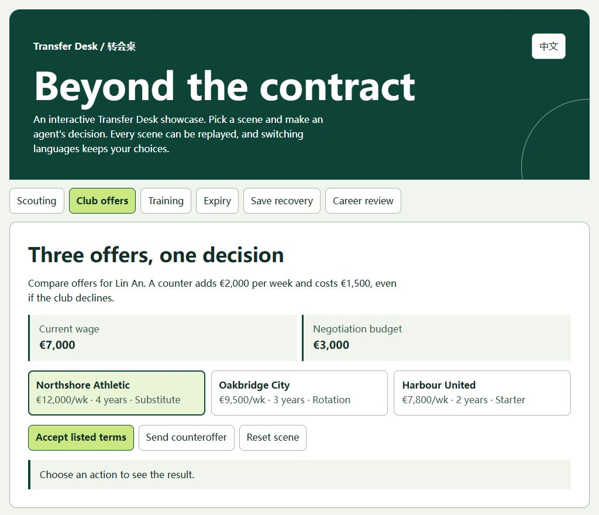
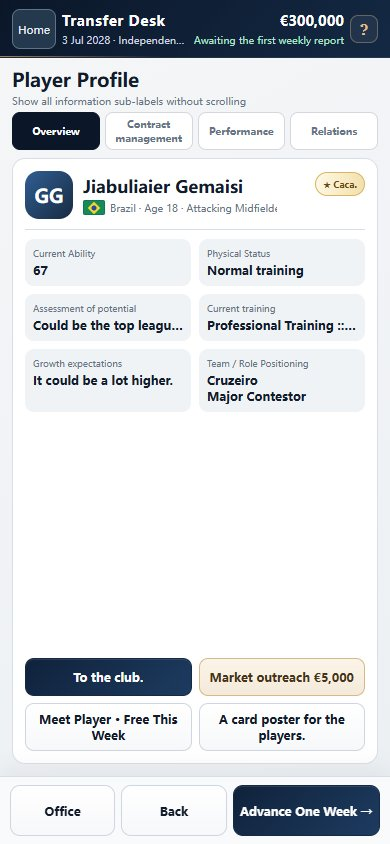

# Transfer Desk · 转会桌

**足球经纪人职业模拟游戏 / A football agent career simulation**

经营一家足球经纪公司：发现球员、评估成长机会、比较报价、处理合同，再让事务所活过一个又一个赛季。

[下载单文件交互展厅](https://raw.githubusercontent.com/GeorgeDy7an/football-transfer-desk/main/showcase.html) · [中英双语游戏画廊](docs/gallery.md) · [开发案例](docs/development.md) · [系统设计与迭代](docs/systems.md)

## 交互展厅 / Interactive showcase

将 `showcase.html` 保存到本地并用浏览器打开即可。一个 HTML，支持中文 / English，无须安装或联网。选择一个场景，动手作出决定，再切换语言或重置重试。

| 场景 | 可以亲手做什么 |
| --- | --- |
| 球探 | 比较两份报告，加入观察名单或用预算复查 |
| 球队报价 | 比较周薪、年限和出场定位；直接接受或反报价 |
| 训练配置 | 在两个客户间分配一个重点名额，或购买额外名额 |
| 合同到期 | 续签或结束代理关系，观察球队合同不受影响 |
| 保存重试 | 模拟一次写入失败，再保存同一周快照，检查现金没有重复扣除 |
| 生涯结算 | 生成五年或十年的模拟个人战报 |

展厅用虚构数据和独立脚本模拟局部流程，与正式游戏的 HTML、数据、规则和存档分开。[单场景谈判代码示例](demo/negotiation.js)及其[测试](tests/negotiation.test.cjs)也可单独阅读。

## 正式版游戏 / Full-game gallery

以下为正式版实机截图，不是展厅渲染。**[查看全部 12 张中英截图](docs/gallery.md)**：首页、事务所、收件箱、球员档案、训练配置和生涯海报。

| 中文 · 事务所 | English · Agency | English · Player profile |
| :---: | :---: | :---: |
|  |  |  |

## English

Transfer Desk is a football agency simulation about the trade-offs between wages, playing time, player development and agency cash flow. The [interactive showcase](showcase.html) lets you try six fictional scenarios in English or Chinese. Save that one HTML file and open it locally. See the [bilingual screenshot gallery](docs/gallery.md) for the full game and the [development notes](docs/development.md) for the design and engineering decisions behind it.

The production source, data and full game builds are private. See [rights and permitted use](NOTICE.md).
