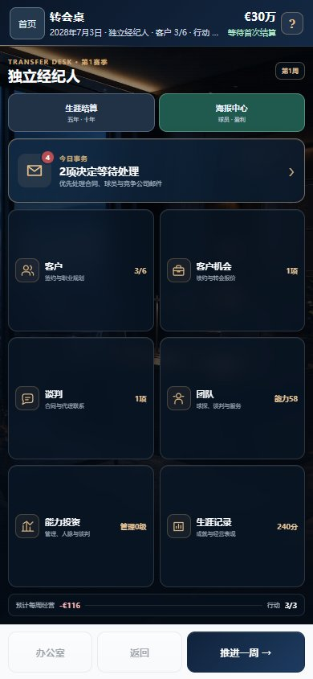
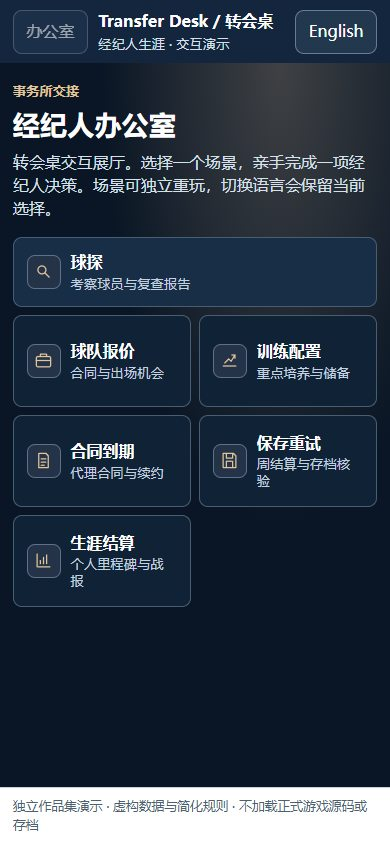
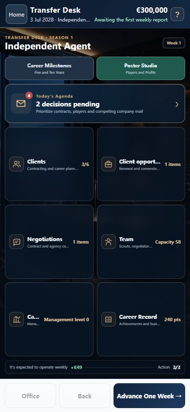
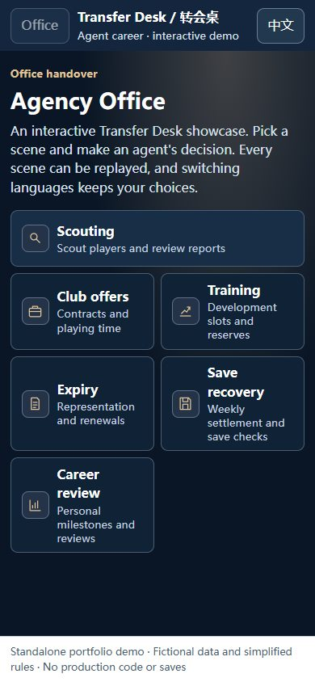

# Transfer Desk · 转会桌

[中文](#中文) · [English](#english)

## 中文

《转会桌》是一款足球经纪人生涯模拟游戏。你经营一家经纪公司：发现球员、评估成长机会、为客户谈判并处理合同，在薪资、出场时间和长期现金流之间作选择。

**[下载单文件交互展厅](showcase.html)** · [中英双语实机画廊](docs/gallery.md) · [开发案例](docs/development.md) · [系统设计与迭代](docs/systems.md)

在 GitHub 的文件页下载 `showcase.html`，用浏览器打开即可。展厅从游戏风格的事务所进入，点选六个场景，可在中英文间切换并保留当前选择和结果。无需联网或安装。

| 场景 | 可以操作什么 |
| --- | --- |
| 球探 | 比较两份报告，加入观察名单或用预算复查 |
| 球队报价 | 比较周薪、年限和角色，接受或反报价 |
| 训练配置 | 在两个客户间分配重点名额，或购买额外名额 |
| 合同到期 | 续签或结束代理关系，检查球队合同是否变化 |
| 保存重试 | 模拟一次写入失败，再保存同一周快照，检查费用只扣一次 |
| 生涯结算 | 生成五年或十年的个人战报 |

| 正式版：事务所 | 独立展厅：事务所 |
| :---: | :---: |
|  |  |

[画廊](docs/gallery.md)收录首页、事务所、收件箱、球员档案、训练和海报，共 12 张实机截图，中英文各 6 张。[谈判规则示例](demo/negotiation.js)与[测试](tests/negotiation.test.cjs)可单独阅读。

展厅用独立代码与虚构数据模拟流程。正式版源码、生产数据、存档和完整版发行包均为私有。参见[权利说明](NOTICE.md)。

## English

Transfer Desk is a football agent career simulation. Run an agency: scout players, assess their development prospects, negotiate deals and handle expiring contracts. Weigh wages, playing time and long-term cash flow.

**[Download the single-file interactive showcase](showcase.html)** · [Bilingual game gallery](docs/gallery.md) · [Development case studies](docs/development.md) · [Systems and iteration](docs/systems.md)

Download `showcase.html` from the GitHub file page and open it in a browser. Start in an office styled after the game, choose from six scenarios and switch languages without losing your choices or results. No installation or network connection is needed.

| Scenario | What you can do |
| --- | --- |
| Scouting | Compare reports, shortlist a player or spend budget on a follow-up |
| Club offers | Compare wages, contract lengths and roles; accept or counter |
| Training | Assign a focus slot to one client or purchase an extra slot |
| Contract expiry | Renew or end representation and see what happens to the club contract |
| Save recovery | Simulate a failed write, then retry the same weekly snapshot and verify the expense is charged once |
| Career review | Generate a five- or ten-year personal review |

| Full game: agency office | Standalone showcase: agency office |
| :---: | :---: |
|  |  |

The [gallery](docs/gallery.md) shows the home screen, office, inbox, player profile, training and poster export, with 12 full-game screenshots: six in each language. The [sample negotiation rules](demo/negotiation.js) and [tests](tests/negotiation.test.cjs) can be read separately.

The showcase uses independent code and fictional data. Production source, data, saves and full game builds are private. See the [rights and permitted use notice](NOTICE.md).
