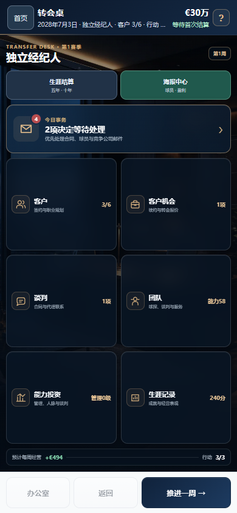
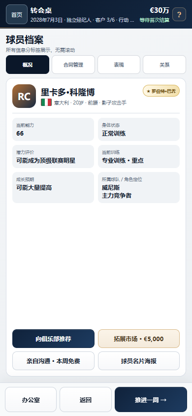

# Transfer Desk · 转会桌

**足球经纪人职业模拟游戏 / A football agent career simulation**

玩家经营一家经纪公司，在薪资、出场机会、球员成长和长期现金流之间做选择。这是项目作品集：包含真实游戏截图、开发案例，以及用虚构数据编写的独立谈判演示。

[查看开发案例](docs/development.md) · [查看谈判演示文件](demo/index.html)

| 事务所 / Agency dashboard | 球员档案 / Player profile |
| :---: | :---: |
|  |  |

### 试玩一个决策

下载此展示仓库并解压，打开 `demo/index.html`。选择一份报价，决定直接接受或加价反谈。你可以切换中文或英文，也可以重置重试。无需安装、联网或登录。

### 项目案例

- **职业路径**：把球员的能力、潜力和出场机会分开，设计有取舍的球队报价。
- **长期存档**：处理坏档隔离、旧档升级、保存核验和重试重复结算。
- **离线版**：拆掉平台依赖，让中英文共用本地存档，把广告机会改成游戏内预算或行动次数。

### English

I built a football agent career simulation around a recurring choice: take the bigger contract now, or find a club that gives the player a better path. The project spans game-system design, a mobile-first interface, long-running career saves and a bilingual offline build.

The screenshots show the full game. The small negotiation demo uses fictional offers and simplified rules. Download and extract this showcase, then open `demo/index.html` to run it locally. [Read the development case studies](docs/development.md).

The production source, data and full game builds are private. See [rights and permitted use](NOTICE.md).
