# 游戏截图 / Full-game screenshots

在完整版《转会桌》的移动端布局中重新截图。每个场景各一张中文和英文；它们是实际游戏画面，不是独立展厅的模拟界面。点击图片可看原图。

Fresh captures from the full offline game's mobile layout, in both Chinese and English. The [interactive showcase](../showcase.html) is a separate simulation.

### 首页 / Home screen

| 中文 | English |
| :---: | :---: |
| [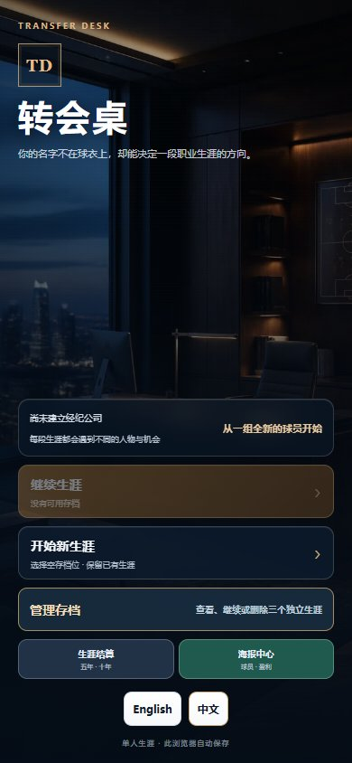](../media/zh-title.jpg) | [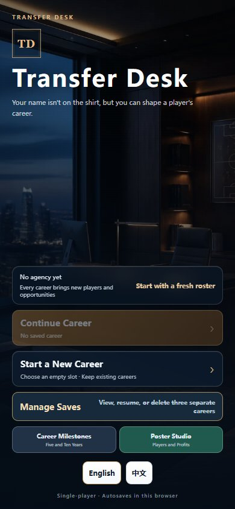](../media/en-title.jpg) |

### 事务所 / Agency dashboard

| 中文 | English |
| :---: | :---: |
| [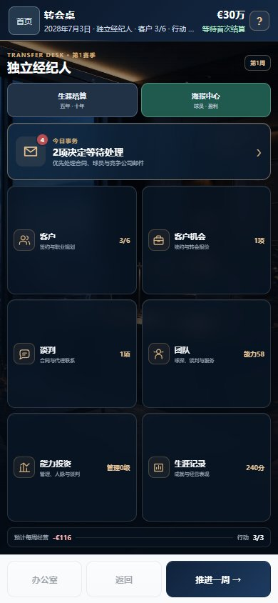](../media/zh-office.jpg) | [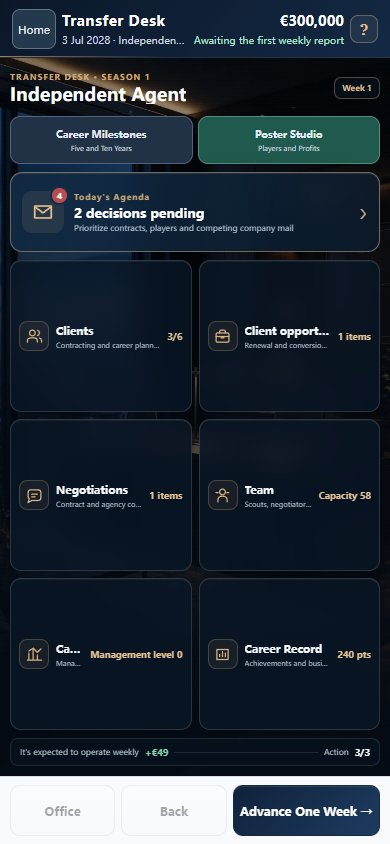](../media/en-office.jpg) |

### 收件箱 / Inbox

| 中文 | English |
| :---: | :---: |
| [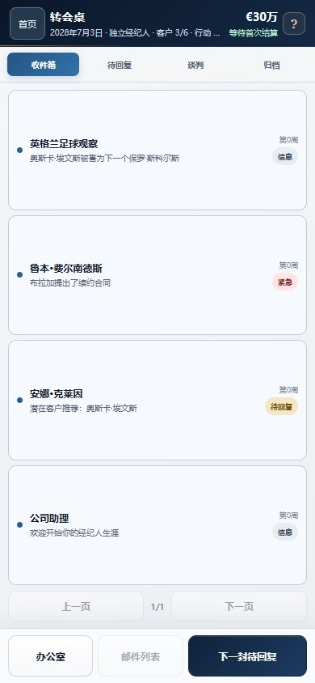](../media/zh-inbox.jpg) | [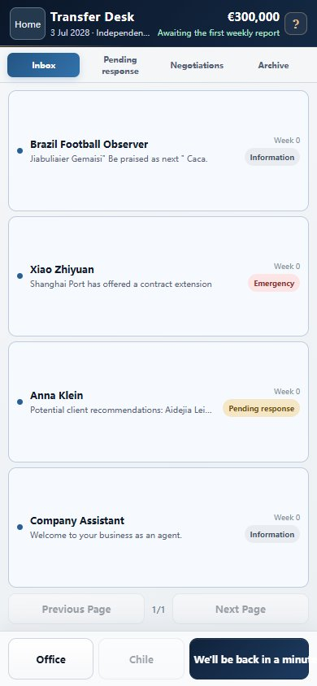](../media/en-inbox.jpg) |

### 球员档案 / Player profile

| 中文 | English |
| :---: | :---: |
| [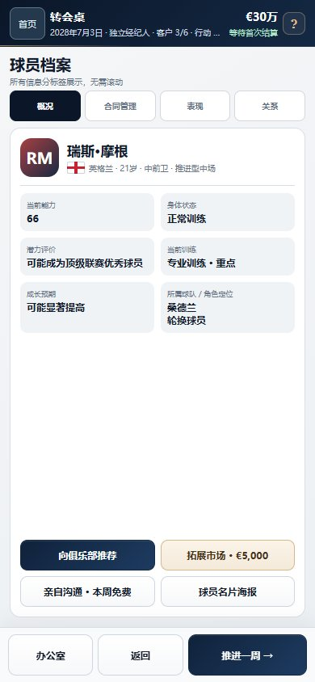](../media/zh-player.jpg) | [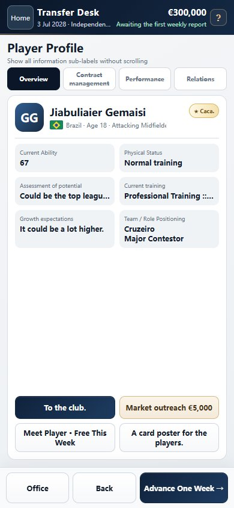](../media/en-player.jpg) |

### 训练配置 / Training

| 中文 | English |
| :---: | :---: |
| [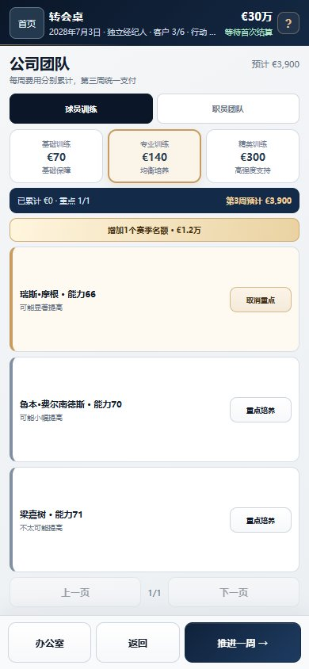](../media/zh-training.jpg) | [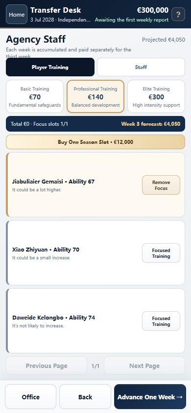](../media/en-training.jpg) |

### 生涯海报 / Career poster

| 中文 | English |
| :---: | :---: |
| [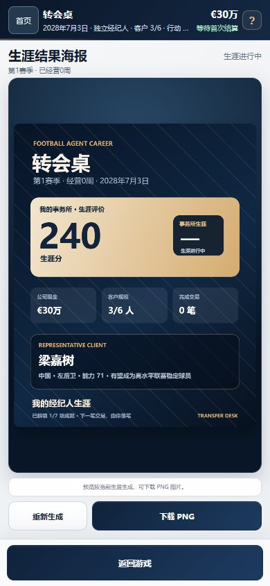](../media/zh-poster.jpg) | [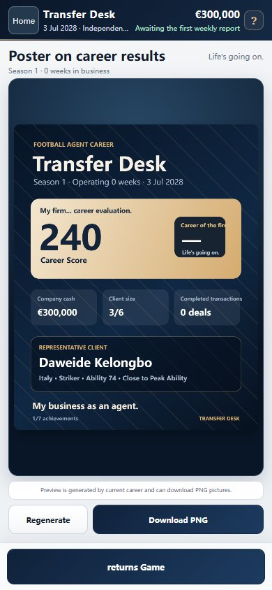](../media/en-poster.jpg) |
